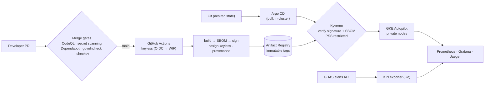

# secure-paved-road


A **paved road** for shipping a Go service to **GKE** where the secure path is
the default path: keyless CI, signed images with SBOM and provenance, merge
gates that require security checks, a cluster that refuses anything it cannot
verify, and a dashboard that shows the security posture as numbers.

> Guardrails over policy documents: every rule here is enforced by a machine
> and demonstrated by a failing case.

## Architecture



CI can publish an image, but it **cannot touch the cluster**: no kubeconfig,
no cluster credentials. Argo CD pulls from inside.

## Stages

| # | Stage | Status |
|---|---|---|
| 1 | Foundation: GCP project, budget, keyless CI identity, registry, private GKE Autopilot — all Terraform | 🔄 code ready |
| 2 | Paved-road Go service + CI: GHAS, govulncheck, signed build, SBOM, provenance, Terraform-managed merge gates | 📋 |
| 3 | Deploy-time policy: Argo CD (bootstrapped by Ansible), Kyverno verifyImages, Pod Security Standards, NetworkPolicy | 📋 |
| 4 | Observability and security KPIs: Prometheus, Grafana, Jaeger, GHAS-alerts exporter in Go | 📋 |
| 5 | AI-generated code: the same gates stop an insecure AI-written PR; review process | 📋 |

Details and checklists: [docs/roadmap.md](docs/roadmap.md) ·
design decisions and scanner triage: [docs/decisions.md](docs/decisions.md) ·
how to build stage 1 on GKE: [docs/gke-stage-1-runbook.md](docs/gke-stage-1-runbook.md).

## Layout

One paved road, several platforms. Everything above the platform layer is
written once; each platform only fulfils the
[platform contract](docs/platform-contract.md) (cluster, registry, keyless CI
identity, workload identity, secrets, admission, networking, audit, cost guard).

```
modules/                      blocks: gcp-project-baseline, gcp-state-bucket, gcp-ci-identity,
                              gcp-registry, gcp-network, gcp-gke-autopilot (tested, see modules/README.md)
platforms/
  gke/terraform/foundation/   composition, long-lived, ~free: baseline + state + CI identity + registry
  gke/terraform/platform/     composition, destroyable: network + GKE Autopilot
  k3s/ · aws/ · azure/         planned: same contract, see docs/platform-contract.md
service/                      planned (stage 2): Go service template, shared by all clouds
policies/                     planned (stage 3): Kyverno admission policies, shared
gitops/                       planned (stage 3): Argo CD apps, one overlay per cloud
tools/posture/                planned: Go CLI/exporter for security posture, shared
.github/                      CI (block tests, validate, tflint, checkov -> code scanning), Dependabot
docs/                         roadmap, decisions, runbooks
```

## Cost

Each cloud's `platform/` is destroyed after every working session
(`terraform destroy`); `foundation/` costs cents. A budget with e-mail alerts is the first resource
created.
